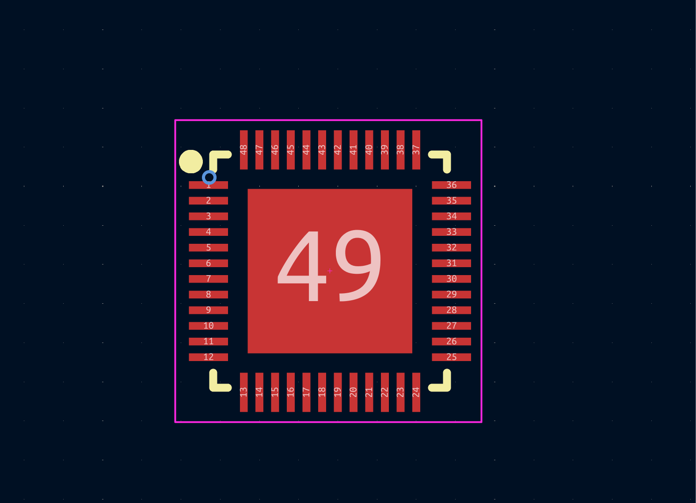
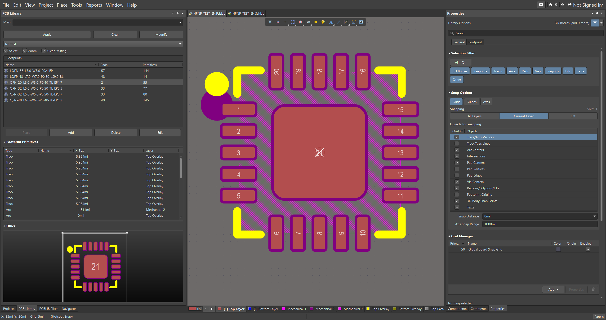
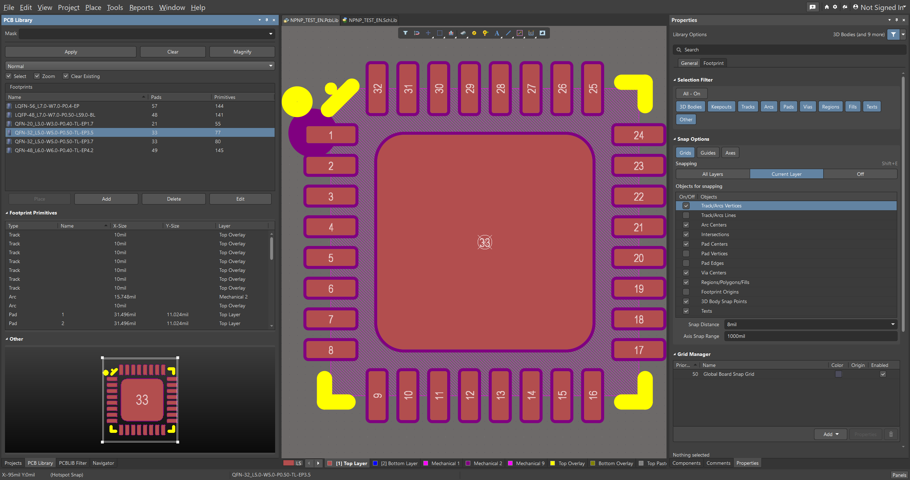
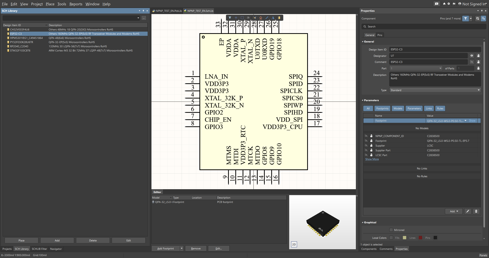
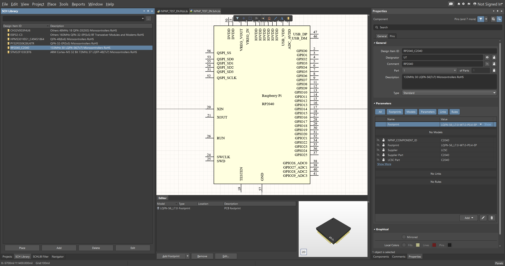

<p align="center">
  
</p>

<h1 align="center">npnp (Normalize Pin Net Pad)</h1>

<p align="center">
  <strong>Batch export LCSC components from the command line into formats supported by Altium Designer (AD) and KiCad.</strong>
</p>

<p align="center">
  <a href=".github/workflows/release.yml"></a>
  <a href="https://www.rust-lang.org/"></a>
</p>

<p align="center"><a href="README.en.md">English</a> | <a href="README.md">简体中文</a></p>

---

## Before You Start

> [!NOTE]
> The source code is public again, but please follow the [LICENSE](LICENSE) when using this project.

`npnp` stands for `Normalize Pin Net Pad`. It is the CLI tool I built while reverse-engineering parts of the `Altium Designer` library format and cleaning up the LCSC / EasyEDA export workflow. It is intended for users who need scripting, batch processing, CI, or simply prefer a command-line tool. If you need a GUI, use the related [`SeEx`](https://github.com/ref42/seex) application.

`npnp` and `SeEx` should keep the same export behavior wherever possible, especially:

- KiCad `3D` export writes downloaded STEP data directly, without the expensive STEP parse-and-rewrite pass.
- KiCad STEP downloads use the same LCSC model endpoint and HTTP transport as Altium.
- Both Altium and KiCad support Chinese or English metadata export; when the requested language is missing, existing source metadata is preserved as fallback.
- Generated libraries are intended for real EDA use, but they should still be visually checked before production.

If you find an issue in exported symbols, footprints, 3D models, or metadata, please open an `issue` with the LCSC ID, target EDA, export command, and screenshots. PRs are not merged by default unless the maintenance direction is agreed in advance.

## What Can npnp Do?

### KiCad

- [x] Export KiCad-compatible `Symbol`, `Footprint`, and `3D` model formats.
- [x] Export individual components or batch export from a text file.
- [x] Append or update existing `.kicad_sym`, `.pretty`, and `.3dshapes` libraries.
- [x] Write STEP models directly into `.3dshapes` and reference them from footprints.

### Altium Designer (AD)

- [x] Export individual `.SchLib` and `.PcbLib` libraries. `.PcbLib` embeds upstream STEP data when available.
- [x] Support batch export.
- [x] Export multiple components into one merged `.SchLib` / `.PcbLib` pair.
- [x] Append new components to an existing npnp merged library without replacing the old components.

### Shared Features

- [x] Export metadata in Chinese or English.
- [x] Use parallel download and batch processing.
- [x] Export `3D` models independently.
- [x] Export raw symbol / footprint JSON for troubleshooting.
- [x] Provide multi-platform Windows, macOS, and Linux release packages.

## Supported EDA Versions

> [!NOTE]
> These are the versions currently known to work. npnp may support additional versions. If a library exported by npnp cannot be opened by an older EDA version, please open an issue so compatibility can be considered.

- [x] `KiCad 9.0` to `Latest`
- [x] `Altium Designer 23.x` to `Latest`

## What Is Planned?

- [ ] Continue improving the current Altium / KiCad workflows and fix more hidden `bugs`.
- [ ] Improve solder mask handling for irregular pads during `.PcbLib` export.
- [ ] Explore a broadly applicable way to remove or hide logo/watermark geometry from downloaded `3D` models.
- [ ] Add more regression fixtures for unusual symbols, footprints, and `3D` models.
- [ ] Improve documentation for batch merge, append, and CI workflows.

## Downloads

Each tagged release builds native `npnp` CLI archives for:

- Windows x86_64: `npnp-vX.Y.Z-windows-x86_64.zip`
- Windows ARM64: `npnp-vX.Y.Z-windows-aarch64.zip`
- Linux x86_64: `npnp-vX.Y.Z-linux-x86_64.tar.gz`
- Linux ARM64: `npnp-vX.Y.Z-linux-aarch64.tar.gz`
- Fedora x86_64: `npnp-vX.Y.Z-fedora-x86_64.tar.gz`
- Fedora ARM64: `npnp-vX.Y.Z-fedora-aarch64.tar.gz`
- Arch Linux x86_64: `npnp-vX.Y.Z-arch-x86_64.tar.gz`
- Arch Linux ARM64: `npnp-vX.Y.Z-arch-aarch64.tar.gz`
- macOS Intel: `npnp-vX.Y.Z-macos-x86_64.tar.gz`
- macOS Apple Silicon: `npnp-vX.Y.Z-macos-aarch64.tar.gz`

## CLI

Type `npnp --prompt` to print ready-to-run commands. Export commands are grouped by target EDA tool:

```bash
npnp search C2040 --limit 5

npnp altium export C2040 --full --output altium-libs --force
npnp altium batch --input ids.txt --output generated/altium --merge --library-name MyLib --full --continue-on-error
npnp altium batch --input new_ids.txt --output generated/altium --merge --append --library-name MyLib --full --force --continue-on-error

npnp kicad export C2040 --full --output kicad-libs --library-name MyParts --force
npnp kicad batch --input ids.txt --output generated/kicad --library-name MyParts --full --force --parallel 4 --continue-on-error
```

Useful shared flags:

- `--full`: export all supported library targets for that EDA tool.
- `--force`: replace existing generated outputs.
- `--english-metadata`: prefer English metadata when available, while falling back to source metadata when it is missing.
- `--library-name`: set the merged Altium library name or KiCad library base name.
- Altium `--merge` creates a new merged library and refuses to overwrite an existing one. Use `--merge --append` to add components to an existing merged library.

## Export Examples

<table>
  <summary>KiCad examples</summary>
  <tr>
    <td align="center"><br /><sub>Symbol library</sub></td>
    <td align="center"><br /><sub>Footprint library</sub></td>
    <td align="center"><br /><sub>3D model</sub></td>
  </tr>
</table>

<table>
  <summary>Altium PCB library examples</summary>
  <tr>
    <td></td>
    <td></td>
    <td></td>
  </tr>
  <tr>
    <td></td>
    <td></td>
    <td></td>
  </tr>
</table>

<table>
  <summary>Altium SchLib examples</summary>
  <tr>
    <td></td>
    <td></td>
    <td></td>
  </tr>
  <tr>
    <td></td>
    <td></td>
    <td></td>
  </tr>
</table>

## References And Thanks

- Thanks to [`easyeda2kicad`](https://github.com/uPesy/easyeda2kicad.py) and [uPesy](https://github.com/uPesy) for the project's original inspiration.
- Thanks to everyone who helped test unusual components, footprints, symbol directions, 3D models, and cross-platform release packages.
