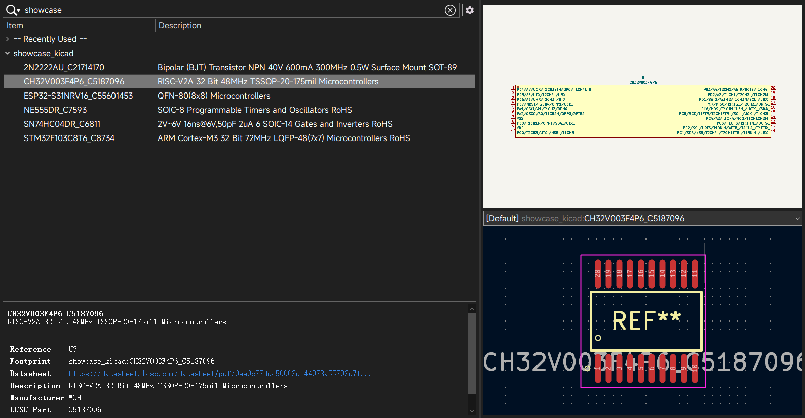
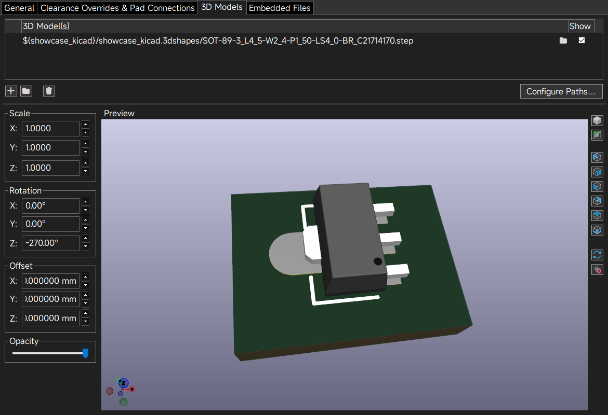
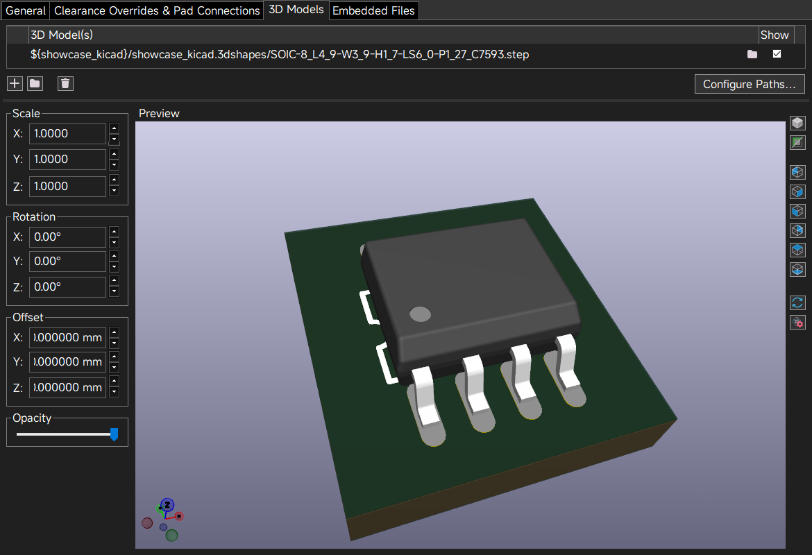
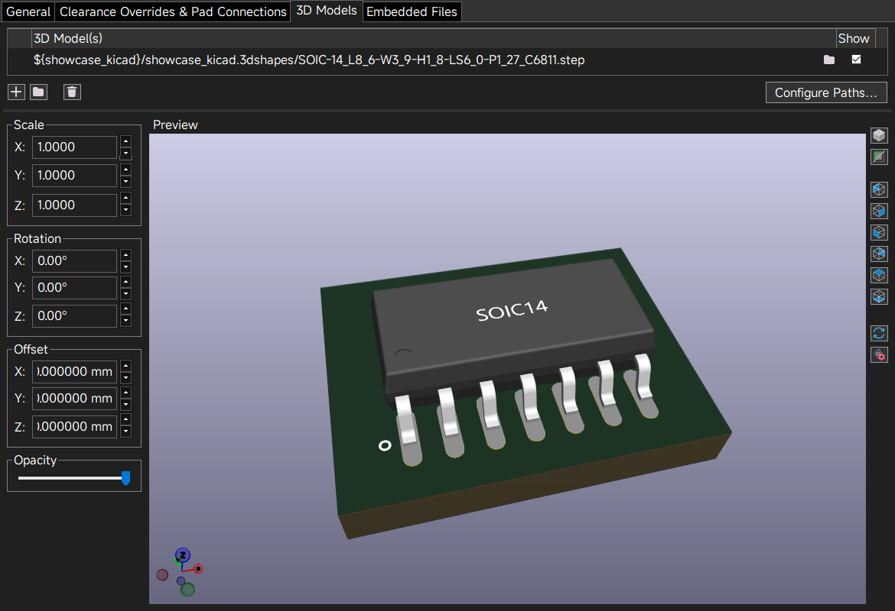
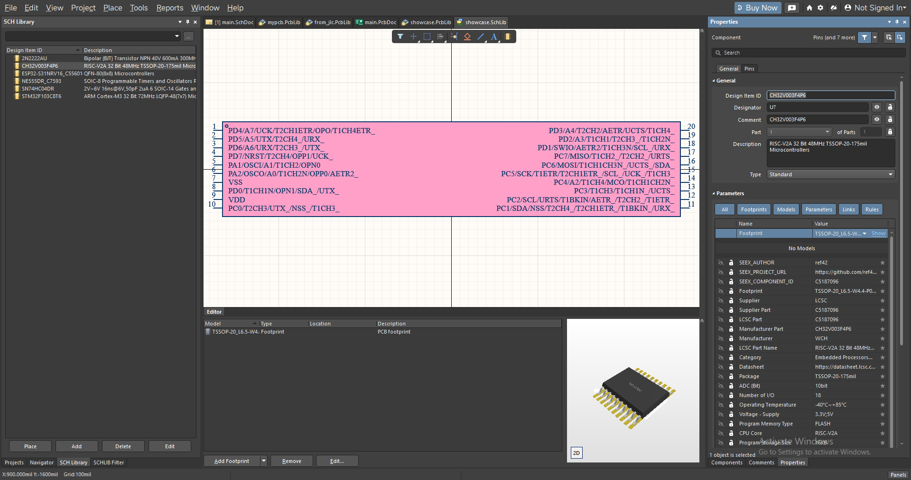
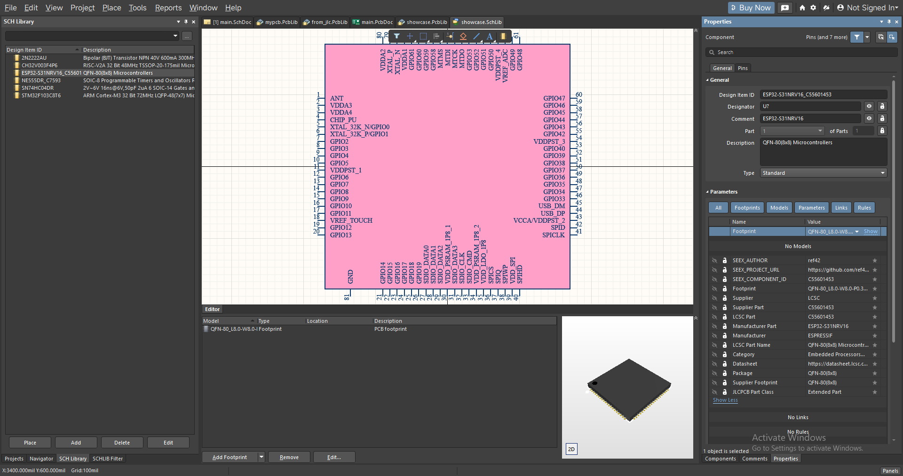
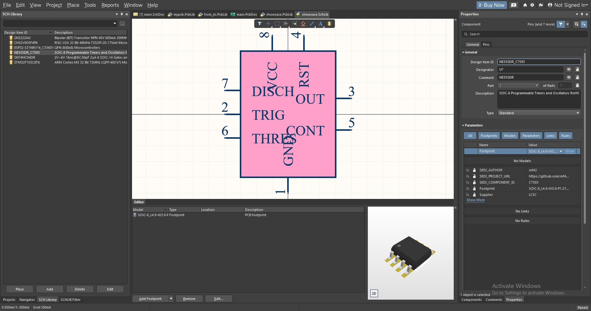
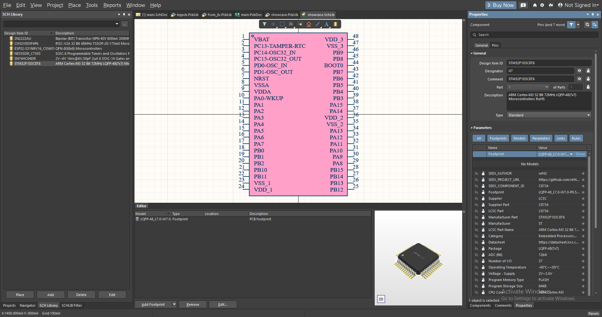
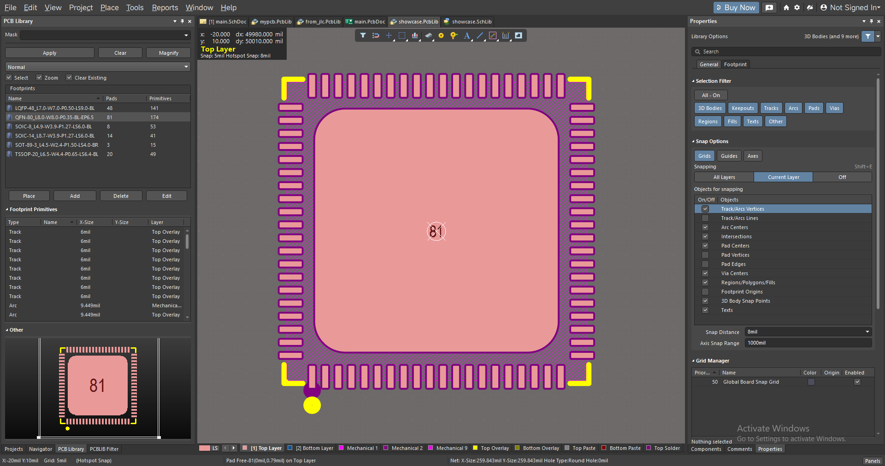
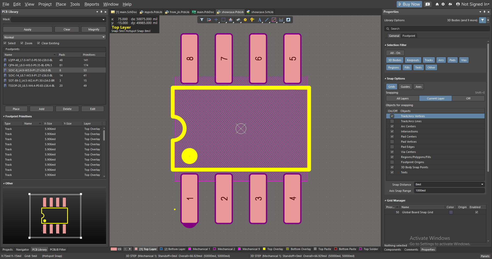

<p align="center">
  
</p>

<h1 align="center">npnp (Normalize Pin Net Pad)</h1>

<div align="center">

[](https://github.com/ref42/npnp/releases) [](https://crates.io/crates/npnp) [](LICENSE) [](https://github.com/ref42/npnp/actions/workflows/ci.yml) [](https://github.com/ref42/npnp/releases)

    

</div>

<p align="center"><a href="README.en.md">English</a> | <a href="README.md">简体中文</a></p>

---

**npnp** 是一个把立创商城元件批量导出为 Altium Designer（AD）、KiCad、Cadence（OrCAD Capture / Allegro）可用格式的命令行工具，适合脚本化、批处理和 `CI`。

## ✨ 功能特性

### KiCad

- [x] 导出 KiCad 可用的 `Symbol`、`Footprint`、`3D` 模型。
- [x] 支持单个器件导出，也支持从文本文件批量导出。
- [x] 支持指定现有 `.kicad_sym`、`.pretty`、`.3dshapes` 库并追加/更新器件。
- [x] STEP 模型直接写入 `.3dshapes`，并在封装中生成模型引用。

### Altium Designer（AD）

- [x] 单独导出器件的 `.SchLib` 和 `.PcbLib`，`.PcbLib` 会嵌入上游 STEP 模型。
- [x] 支持批量导出。
- [x] 支持多个器件合并导出到同一组 `.SchLib` / `.PcbLib`。
- [x] 支持向已有的 npnp 合并库追加新器件，避免因为同名库覆盖而丢失已有器件。

### Cadence（OrCAD Capture / Allegro）

- [x] 导出 `Capture` 原理图符号：一个 `Library XML` 文件，在 `Capture` 中通过 `File > Import > Library XML` 转换为 `.olb`；立创 EDA 的多 part 符号会导出为同一个器件的多个 section。
- [x] 导出 `Allegro` 封装：每个封装一个 `SKILL` 脚本，外加一个库脚本；在 `Allegro PCB Editor` 命令窗口执行 `skill load("<库>_allegro/<库>.il")`，即在同一目录生成 `.dra`、`.psm` 和 `.pad`。
- [x] 导出 `3D` 模型（`step`），封装中已按立创 EDA 的位置映射好模型。
- [x] 标准封装（贴片阻容、`SOT`、`SOD`、`SOIC`、`QFN` 等）按 `IPC-7352` 计算焊盘并核对厂家焊盘；其余封装保留厂家焊盘，按 `IPC-7352` 规则生成丝印、装配层和占位区。
- [x] `npnp` 本身不调用任何 `Cadence` 程序，导入由用户在 `Cadence` 中完成。

### 共同特性

- [x] 支持选择中文或英文元数据导出。
- [x] 支持多线程/并行下载和批处理。
- [x] 支持单独导出 `3D` 模型。
- [x] 默认去除下载 `3D` 模型上的立创 EDA 标志（水印）并重建模型；无法安全去除时保留原模型，并在导出结果中列出这些元件。`--keep-model-logo` 可保留原始模型。
- [x] 支持导出原始 symbol / footprint JSON，便于问题排查。
- [x] 支持 Windows、macOS、Linux 多平台发布包。

## 🔄 工作流

<div align="center">
  
</div>

## 📸 导出示例

<table>
  <summary>KiCad 符号与封装示例</summary>

  <table>
    <tr>
      <td></td>
      <td></td>
      <td></td>
    </tr>
    <tr>
      <td></td>
      <td></td>
      <td></td>
    </tr>
  </table>
</table>

<table>
  <summary>KiCad 3D 模型示例</summary>

  <table>
    <tr>
      <td></td>
      <td></td>
      <td></td>
    </tr>
    <tr>
      <td></td>
      <td></td>
      <td></td>
    </tr>
  </table>
</table>

<table>
  <summary>Altium SCH + 3D 模型库示例</summary>

  <table>
    <tr>
      <td></td>
      <td></td>
      <td></td>
    </tr>
    <tr>
      <td></td>
      <td></td>
      <td></td>
    </tr>
  </table>
</table>

<table>
  <summary>Altium PCB 示例</summary>

  <table>
    <tr>
      <td></td>
      <td></td>
      <td></td>
    </tr>
    <tr>
      <td></td>
      <td></td>
      <td></td>
    </tr>
  </table>
</table>

## 🖥️ 支持的 EDA 版本

> [!NOTE]
> 这些版本仅为目前所知，不排除 `npnp` 支持更多版本。如果你无法在更低版本的 EDA 软件中打开导出的库，可以在 `issue` 里提出。

- [x] `KiCad 9.0` ~ `Latest`
- [x] `Altium Designer 23.x` ~ `Latest`
- [x] `Cadence SPB 26.1`（OrCAD X Capture / Allegro X）；`Allegro` 封装脚本需要支持 `SKILL` 的版本（`Allegro PCB Designer` 或 `OrCAD PCB Designer Professional`）

## 🚀 安装与使用

### 下载

每个 tag release 会构建这些原生 `npnp` CLI 压缩包：

- Windows x86_64：`npnp-vX.Y.Z-windows-x86_64.zip`
- Windows ARM64：`npnp-vX.Y.Z-windows-aarch64.zip`
- Linux x86_64：`npnp-vX.Y.Z-linux-x86_64.tar.gz`
- Linux ARM64：`npnp-vX.Y.Z-linux-aarch64.tar.gz`
- Fedora x86_64：`npnp-vX.Y.Z-fedora-x86_64.tar.gz`
- Fedora ARM64：`npnp-vX.Y.Z-fedora-aarch64.tar.gz`
- Arch Linux x86_64：`npnp-vX.Y.Z-arch-x86_64.tar.gz`
- Arch Linux ARM64：`npnp-vX.Y.Z-arch-aarch64.tar.gz`
- macOS Intel：`npnp-vX.Y.Z-macos-x86_64.tar.gz`
- macOS Apple Silicon：`npnp-vX.Y.Z-macos-aarch64.tar.gz`

### 安装

```bash
cargo install npnp
```

或者从源码构建：

```bash
git clone https://github.com/ref42/npnp.git
cd npnp
cargo build --release
```

可执行文件位于 `target/release/npnp.exe`。

### 命令示例

运行 `npnp p` 可以打印可直接复制的命令。导出命令按目标 EDA 工具分组：

```bash
npnp search C2040 --limit 5

npnp altium C2040 -o altium_libs
npnp altium -i ids.txt -o altium_libs --name MyParts -j 42
npnp altium -i new_ids.txt -o altium_libs --name MyParts --append -j 42

npnp kicad C2040 -o kicad_libs --name MyParts
npnp kicad -i ids.txt -o kicad_libs --name MyParts -j 42
npnp kicad -i new_ids.txt -o kicad_libs --name MyParts --append -j 42

npnp cadence C2040 -o cadence_libs --name MyParts
npnp cadence -i ids.txt -o cadence_libs --name MyParts -j 42
npnp cadence -i new_ids.txt -o cadence_libs --name MyParts --append -j 42

npnp model C2040 -o step_models
npnp model -i ids.txt -o step_models -j 42
```

常用统一参数：

- `--full`：导出该 EDA 工具支持的全部库目标。
- `--force`：替换已有生成结果。
- `--language auto|en|zh`：选择元数据语言。`auto` 使用源元数据，`en` 获取英文元数据并在缺失时回退到源元数据。
- `-j`：使用 `-i` 时的最大并发导出数。
- `-i`：从任意纯文本文件读取器件 ID，文件名不要求使用 `.txt` 扩展名。
- `--name`：可选参数，用于覆盖生成库的基础名称。
- `--append`：更新 `-o` 指定目录中的库集合。Altium 会发现合并的 `.SchLib`/`.PcbLib`，KiCad 会发现 `.kicad_sym`、`.pretty` 和 `.3dshapes` 库，Cadence 会向已有的 `<库名>.xml` 和 `_allegro` 目录追加。
- `--keep-model-logo`：保留下载 `3D` 模型上的立创 EDA 标志（默认会去除）。

### 合并现有库

```bash
npnp merge -i path/to/libraries -o merged/MyParts
npnp merge -i path/to/libraries -o merged/MyParts --force
```

将待合并的库直接放在输入目录中。命令自动识别 Altium 或 KiCad；两种格式应放在不同目录。本命令离线运行，不转换 EDA 格式。

- Altium：将 `.SchLib` 和 `.PcbLib` 文件分别合并为 `MyParts.SchLib`、`MyParts.PcbLib`。
- Altium 会在重复执行时排除本次指定的输出文件。同名器件保留第一份记录，因此更换输出名时，之前的合并库可以与源库共存。
- KiCad 6 及以上：将 `.kicad_sym` 文件、`.pretty` 目录、`.3dshapes` 目录分别合并为 `MyParts.kicad_sym`、`MyParts.pretty`、`MyParts.3dshapes`。可以只提供其中部分类型；模型子目录会保留。
- `-o` 指定输出基础路径，不是输出目录。已有输出需要 `--force` 才会替换。KiCad 会从输入中排除本次指定的输出库，允许在同一目录重复执行；替换会移除输出库目录中的旧文件，但不允许将输出嵌套在源库目录内。
- KiCad 同名且内容一致的条目只保留一份，符号和封装在更新引用后比较，忽略空白格式差异。因此更换输出名时，之前的合并库可以与源库共存。同名但内容不同仍会在写出前报错，`--force` 不会忽略冲突。不合并旧版 `.lib` 符号库或不支持的库级元数据。
- 若引用的封装也在输入中，符号的封装引用会更新。模型引用会改为复制后文件的绝对路径，无需增加 KiCad 路径变量；外部引用保持不变。移动合并后的文件时，需要在 KiCad 中修改模型路径，或在新位置重新合并。

在 KiCad 符号库表中添加 `MyParts.kicad_sym`，在封装库表中添加 `MyParts.pretty`，库昵称均使用 `MyParts`。

### 导出约定

- 生成的器件和模型名称是确定性的：`<source-name>__<LCSC-ID>`。原理图库元数据中仍会保留 `NPNP_COMPONENT_ID`。
- 缺少 STEP 数据不会阻止符号或封装导出；目标支持 3D 导出时，终端摘要会标明缺少模型的数量。
- Cadence 目标写出 `<库名>.xml`（Capture Library XML）、`<库名>_allegro/`（每个封装一个 `SKILL` 脚本加一个库脚本）和 `<库名>_step/`（`3D` 模型）。`npnp` 不调用 Cadence：`.olb` 由 Capture 的 `File > Import > Library XML` 生成，`.dra`/`.psm`/`.pad` 由 Allegro 命令窗口执行 `skill load("<目录>/<库名>.il")` 生成。
- 新建合并库不会覆盖已有库。使用 `--append` 保留已有库并添加新器件；只有在确实需要替换独立生成文件时才使用 `--force`。
- 生成的库文件面向实际 EDA 使用，但在用于生产前仍然建议目检确认。

## 📖 写在开头

> [!NOTE]
> 项目源码已重新公开，但请务必遵循 [LICENSE](LICENSE) 进行使用。

`npnp` 是 `Normalize Pin Net Pad` 的缩写，也是我在逆向 `Altium Designer` 文件格式、整理立创/EasyEDA 数据导出流程时做出的 CLI 工具。它适合需要脚本化、批处理、CI 或者更喜欢命令行的用户；如果你需要 GUI，可以使用同系列的 [`SeEx`](https://github.com/ref42/seex)。

目前 `npnp` 和 `SeEx` 的导出行为会尽量保持一致，尤其是以下部分：

- `3D` 模型会先调整到板面位置再写入，默认还会去除立创 EDA 标志，两个前端得到的是同一份模型。
- `KiCad`/`Altium` 的 `STEP` 下载使用同一套 LCSC 模型接口和 HTTP 连接方式，`lceda.cn` 不可用时会回退到 `easyeda.com` 镜像。
- `Altium`、`KiCad`、`Cadence` 都支持中英文元数据导出；当目标语言元数据缺失时，会保留并回退到已有源数据。
- 生成的库文件面向实际 EDA 使用，但在用于生产前仍然建议目检确认。

如果你发现导出的符号、封装、3D 模型或元数据有问题，欢迎提 `issue`，请尽量附上 LCSC 编号、目标 EDA、导出命令和截图。PR 默认不会直接合并，除非事先沟通确认维护方向。

## 🧩 姐妹项目

- [`SeEx`](https://github.com/ref42/seex) 是 `npnp` 的 `GUI` 版本，功能与 `npnp` 对齐，适合更喜欢界面的用户。
  - 监听剪贴板、搜索器件、预览、导出都在一个窗口里完成。
  - 需要 `Cadence` 目标时，两个项目写出的是同一套 `Library XML` 与 `SKILL` 脚本。
  - `npnp` 更适合 `AI`/`Agent` 直接调用：让 `AI` 分析工程，再调用 `npnp` 导出需要的元件。

## 🗺️ 路线图

- [ ] 继续完善现有 Altium / KiCad / Cadence 工作流，修复更多隐藏的 `bug`。
- [ ] 改进不规则焊盘导出 `.PcbLib` 时的阻焊处理。
- [ ] 支持更多 `EDA` 工具，例如 `PADS`。
- [ ] 增加更多异常符号、封装、3D 模型的回归测试样例。
- [ ] 完善批量合并、追加和 CI 使用文档。

## 🤝 贡献

- [x] 具有软件设计经验，能持续维护软件。
- [x] 审美在线，非常期待得到您的宝贵建议。
- [x] 如果你的 `Token` 花不完，同时也对本项目感兴趣，大可进行尝试，本项目不排斥使用 `AI`，只需确保提交 `PR` 的时候，所有作者为物理世界存在的活人即可。
- [x] 并不一定需要贡献代码，所有能帮助 `npnp` 和 `SeEx` 变得更好用的建议都会被考虑，并会在文末致谢。

## 🙏 致谢

以下排名不分先后，仅按照软件开发时的时间线进行排序。

### 参考

- [`easyeda2kicad`](https://github.com/uPesy/easyeda2kicad.py)@[uPesy](https://github.com/uPesy)
  - 虽然只支持 `KiCad`，但也给了我一部分灵感，这是一个很优秀的工具，市面上 `KiCad` 相关的 `easyeda` 导入插件，绝大多数都是在这个工具的基础上进行开发的。
- `IPC-7352(2023)` https://dokumen.pub/qdownload/ipc-7352-generic-guideline-for-land-pattern-design.html
  - 用于 `Cadence` 的焊盘计算与 `3D` 模型重建。

### 致谢

- 菊猫大佬
  - 赠送给我一部分 `TOKEN`，虽然也自费购买了一部分，但是最后算下来也属于半买半送了，那个时候 `opus 4.6` 还很好用，猛蹬 `opus 4.6`，实现了很多功能，打下了好的基础。
- `emoji` 老弟@[z217-cpu](https://github.com/z217-cpu)
  - 帮忙测试了多平台兼容性，从项目伊始直至现在都一直在帮我测试，非常感谢！
- `🐏🐏`@[Cloud-Lightning](https://github.com/Cloud-Lightning)
  - 曾在多个项目里使用 `seex`/`npnp`，并且给了我非常多的实用建议，非常感谢！
- `c大佬`@[lins-code54](https://github.com/lins-code54)
  - 为 `SeEx` 提供了导出 `Cadence` 的支持，`npnp` 的 `Cadence` 目标也来自这份工作；同时还提供了 `3D` 模型的重建功能；非常感谢！
- 所有用户
  - 如果没有你们的下载与 `star`，可能这个项目会被我搁置，非常感谢！

## 📄 许可证

本项目采用自定义的 **npnp Non-Commercial Share-Alike License 1.0**：允许学习、修改与再分发，但**禁止任何形式的商业使用**，且修改后的作品需以相同许可共享。完整条款请参阅 [LICENSE](LICENSE)。

> [!NOTE]
> 项目源码虽已公开，但请务必遵循 [LICENSE](LICENSE) 进行使用。

## 版权声明

`Altium`、`Altium Designer` 是 Altium Limited 的商标；`Cadence`、`OrCAD`、`Allegro` 是 Cadence Design Systems, Inc. 的商标；`立创商城`、`立创EDA`、`嘉立创` 是深圳嘉立创科技集团股份有限公司的商标。`KiCad` 是 KiCad 项目及其开发者社区的名称与标识，代码以 GPL 发布。本项目与上述公司及项目均无关联，相关名称仅用于说明兼容性。
